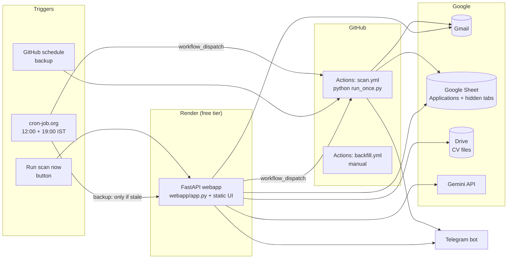
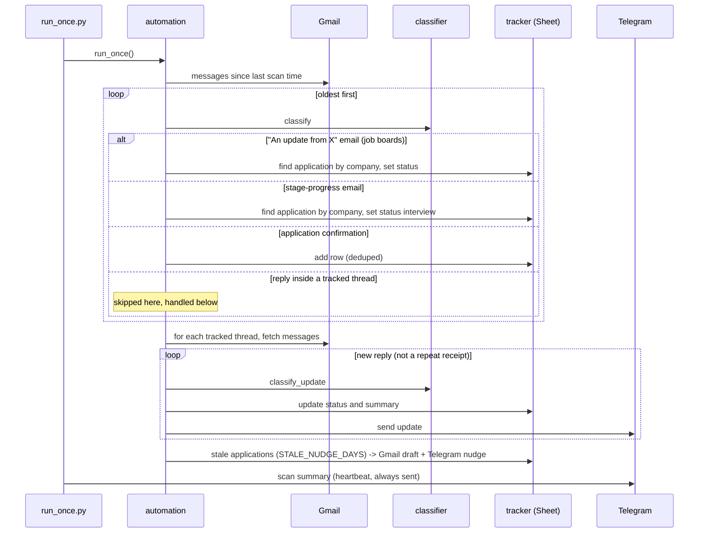
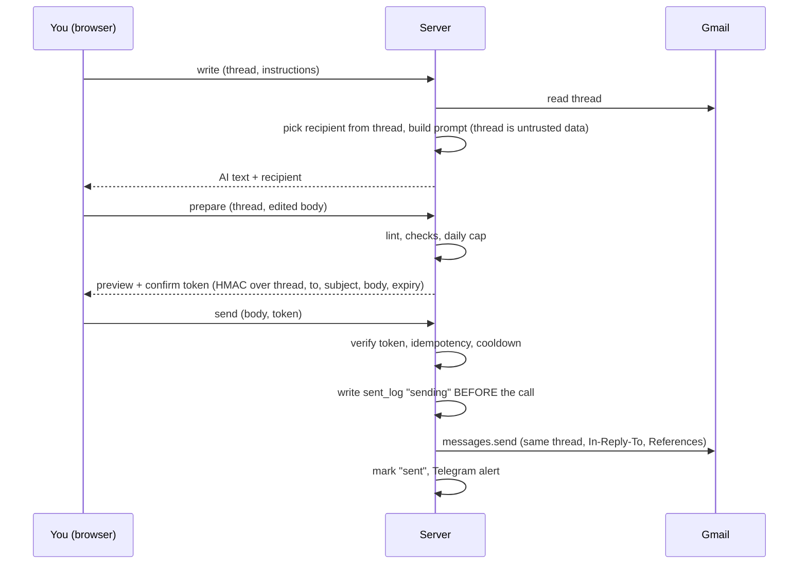

# Job Tracker: Architecture

A personal job-application tracker that runs at zero cost. It reads your Gmail, records each application in a Google Sheet, tells you about replies on Telegram, and has a small web portal for viewing applications, tailoring CVs with AI, and writing or sending replies.

Status of this document: describes the system as built (single user), organised by delivery phase. Phases 0 to 5 are built and deployed. Phase 6 (multi-user) is built; Phase 7 (installable app and notifications) is built; Phase 8 (one home for the owner's data) is built; Phase 9 (reply writer and send) is built and deployed; Phase 10 (NextStep brand, portal UI and open beta access) is built; Phase 11 (always-on hosting) is built and deployed; Phase 12 (Market Analyst split) is built and deployed; Phase 13 (mobile layout) is built and deployed; Phase 14 (app UX update) is built and being tested. Unscheduled ideas are listed under Future aspects.

## Delivery phases

The project is delivered in phases. Each phase has a goal, what shipped, and an exit check. Work is done one phase at a time.

| Phase | Name | Status |
|---|---|---|
| 0 | Original local tool | Done |
| 1 | Cloud migration and webapp | Done |
| 2 | Reliable scheduling and operations | Done |
| 3 | Data quality and recovery | Done |
| 4 | Portal experience and replies | Done |
| **5** | **Status accuracy and scheduler cleanup** | **Current** |
| 6 | Follow-up reminders | Next |
| 7 | Multi-user accounts | Later |

### Phase 0: Original local tool (done)
Goal: stop losing track of applications.
- Gmail scan on a laptop, results in a local Excel file, Telegram messages for replies.
- `mcp_server.py` (Claude tools) and `run_daemon.py` (always-on poller).
- Heuristic classifier for confirmations, interviews, rejections, offers.
- Stale-application nudges that create Gmail drafts.

### Phase 1: Cloud migration and webapp (done)
Goal: run with the laptop closed, at zero cost.
- Google Sheet replaces Excel; `_State` tab replaces local `state.json`.
- Scanner moved to GitHub Actions (`scan.yml`); secrets via GitHub secrets.
- FastAPI webapp on Render free tier with password gate.
- Gemini free tier for tailored CVs and cover letters; CV files in Drive; CV history, similarity suggestions, editable prompts.
- PWA (manifest, service worker). Strategy deck and review of the multi-user idea.

### Phase 2: Reliable scheduling and operations (done)
Goal: two scans a day that actually happen.
- Found GitHub `schedule:` to be unreliable; added cron-job.org triggers calling `workflow_dispatch` at 12:00 and 19:00 IST.
- Backup trigger endpoint (`/api/trigger-scan?only_if_stale_minutes=N`) with warm-up pings for Render's sleeping free tier.
- Fixed the Render start command (JSON quote stripping) so Google auth works on Render.
- Telegram scan summary after every run as a heartbeat.

### Phase 3: Data quality and recovery (done)
Goal: trust what is in the sheet.
- Classifier rewrite for shared job-board senders (Wellfound, LinkedIn): company from subject, de-duplication by company and position.
- Fixed four bugs behind a missing application and its rejection (update emails arriving as new threads, replies marked seen too early, oldest-first ordering, over-eager dedupe).
- Layout parsers for LinkedIn, Wellfound and company portals; HTML entity decoding; "Hiring team" suffix trimming; position clean-up.
- `backfill.py` / `backfill.yml` to recover missed mail; `repair_positions.py` to fix bad rows (preview by default).
- Receipt boilerplate no longer read as "interview".

### Phase 4: Portal experience and replies (done)
Goal: use the portal as the daily surface.
- Dashboard: donut chart, status tiles, date ranges (24 hours, 3, 7 days, All), source column and filter, search, pagination.
- Reply with AI: Gemini drafts from the thread and your CV; save to Gmail Drafts; guarded send (off by default).
- Send safeguards: server-chosen recipient, content-bound confirm token, idempotent sent log, daily cap, cooldown, placeholder lint, Telegram tripwire.
- Browser memory of view and reply drafts; last message in the chain shown in the reply window.
- Gemini resilience: timeout, retry, fallback model, thinking-off with 400 fallback.
- Branch-based release and rollback process; this document.

### Phase 5: Status accuracy, scheduler cleanup and document fidelity (done)
Goal: the Status column can be trusted, and each scan runs exactly once.

| # | Item | Result |
|---|---|---|
| 1 | A vague "update" email never overwrites `interview`, `offer` or `rejected` | Implemented in `tracker.update_application`. The summary and date still refresh. |
| 2 | Stage-progress emails ("you're through to the assignment stage") update the matching application and never create a row | Implemented: `classifier.is_stage_progress_email`, new branch in `automation.scan_new_applications`, and `classify_update` maps them to `interview`. Unmatched ones are dropped. |
| 3 | Repair existing stray rows (for example Swymcorp) | `repair_positions.py` blanks the pasted subject and sets the status. |
| 4 | Remove GitHub's own `schedule:` from `scan.yml` | Done. Runs now come only from cron-job.org, the backup endpoint and manual dispatch. |
| 5 | Generated CV keeps the core CV's format, structure and length (one page, two at most) | The core CV is parsed once into a fixed JSON structure (`cv_struct.py`, links read from the PDF). Gemini may only reword allowed text fields; a validator copies everything structural from the original and rejects new numbers, new skills and over-long text. `cv_render.py` draws the PDF in the original design with bundled Carlito fonts. |
| 6 | Cover letter follows the user's own letter format | Header, rule, date, greeting and sign-off are drawn by `cv_render.render_cover_letter`; Gemini writes only 4 short body paragraphs (prompt `cover_letter_v2`). |
| 7 | Out-of-memory restarts on Render (512 MB) | One shared Google client per service with a lock around network calls (`google_auth.get_service`), and a 4-thread cap. Baseline is about 140 MB. |

Exit check: after deploy, run `python3 repair_positions.py` (preview, then `--apply`); confirm the next two scheduled scans fire once each at 12:00 and 19:00 IST; confirm Swymcorp shows `interview`.

### Phase 6: Multi-user accounts (branch `phase-6-multi-user`)
Goal: other job seekers use the portal with their own Google account and their own free Gemini key, at no running cost to the owner, with the owner unable to read their data or keys.

Decisions (confirmed)
- Data store: Firestore (Firebase free tier). Each user's data sits under `users/{uid}` and security rules allow only that user.
- Scanning: on demand, when the user opens the portal or clicks Scan. No schedules and no per-user servers.
- Secrets: nothing secret is stored on the server. See the design below.
- First release: sign-in, own data, own Gemini key, Gmail connection and scan per user. Reply writer and send, and the pipeline board and export, come after the first release.
- Ownership: the multi-user app runs under a separate project Google account (not the owner's personal one): the new Firebase project, Google Cloud OAuth app and consent screen, and its support email all belong to it. The personal account stays only for the existing single-user instance, whose Sheet and Gmail are personal.
- The existing single-user instance stays as it is while this is built beside it (new code under `multiuser/`, reusing `src/` modules).

Design
1. Sign-in: Firebase Auth with Google. The browser holds the login; the server only verifies the Firebase ID token on each call and learns the user id. It keeps no sessions.
2. Stateless server: the multi-user server stores nothing. The browser reads and writes Firestore directly (rules: `request.auth.uid == userId`). For work that needs Python (CV parsing and tailoring, PDF drawing, email classification), the browser sends the inputs, the server computes and returns the result, and the browser saves it. The server needs no database credentials, so the owner cannot read user data through it.
3. Gemini key: the user pastes their own key once. It is encrypted in the browser (AES-GCM, key derived from a vault passphrase with PBKDF2) and only the encrypted text is stored in Firestore. Per session the user unlocks it with the passphrase; the browser sends the key in a request header for each AI call over HTTPS; the server uses it for that call and discards it. Logs never include headers or bodies. Note: Google sign-in has no secret to derive a key from, so a passphrase is needed. A forgotten passphrase means the user enters their key again.
4. Gmail: no Gmail tokens are stored. The browser asks Google for a short-lived access token (Google Identity Services, `gmail.readonly`) when the user scans, sends it with the scan request, and the server reads the mail, classifies it and returns new applications. The token is used once and dropped. Reading new mail only needs read access; sending stays out of the first release.
5. Limits: per-user rate limit and size caps on the server; scan window limited (for example the last 60 days on first scan); Gemini 429 from the user's own quota is shown plainly.

Milestones
| # | Milestone | Exit check |
|---|---|---|
| M1 | Firebase project, Google sign-in, server verifies the ID token, empty per-user portal shell | Two different Google accounts sign in and see separate empty dashboards |
| M2 | Gemini key vault, core CV upload and parse, CV and cover letter generation with the user's own key | A user generates a CV and letter; the owner's key is never used |
| M3 | Gmail connect (access token), on-demand scan, applications in Firestore, dashboard and filters | A user's own applications appear and nobody else's do |
| M4 | Hardening: security rules tests, rate limits, log scrubbing, error messages, docs; second-account test | Isolation checks pass and a fresh user can onboard unaided |

Open risks
- Google treats `gmail.readonly` as a restricted scope. Until the app passes Google's verification (which includes a paid security assessment), the OAuth app stays in testing mode: at most 100 named test users, an "unverified app" warning, and the owner must add each user's email. Plan for a small invited group first.
- Gemini free-tier limits are per key; heavy use hits the user's own quota, not the owner's.
- Firestore free tier (about 50k reads and 20k writes per day across all users) caps how many active users fit; the dashboard must read in pages and cache.
- Render free tier still sleeps and has 512 MB; the stateless server should stay small.
- Migrating the owner's current Sheet data into Firestore is optional and not part of the first release.

Exit check: a second person signs up, adds their key, connects Gmail, sees only their own applications and generates a CV, while the owner's data and key are untouched.

### Phase 7: Installable app and notifications (branch `phase-7-pwa-notifications`)
Goal: users can install the multi-user portal as an app and get notified about changes found by a scan.

Decisions (confirmed)
- The owner's own scheduled scans (cron-job.org) and Telegram alerts stay exactly as they are on the single-user portal. Other users do not get scheduled scans or Telegram.
- Other users get notifications through the installed app (PWA), not WhatsApp (WhatsApp business messages are not free) and not Telegram.
- Accepted limit: a notification can only fire when a scan runs, so there are no alerts while the app is closed. Background scanning would need each user's long-lived Gmail permission stored on a server, which breaks the "nothing secret is stored" rule from Phase 6, so it is not part of this phase.

Built
- Web app manifest, icons (including a maskable one) and a service worker served from the site root. The worker caches only the manifest and icons; it never touches `/api/`, sign-in pages or user data.
- Install button in the header (and the browser or phone menu); on iPhone, Add to Home Screen.
- Notifications card in Setup: the user allows notifications once; after a scan finds new applications, or a rejection, interview or offer, a notification summarises it. Tapping it opens the app.
- Auto-scan when the app is opened or returns to the foreground and the last scan is over 30 minutes old. If the browser blocks Google's permission window (no tap), it falls back to a "Tap Scan" hint.

Exit check: install the app on a phone and a laptop, turn on notifications, run a scan that finds a new application, and see the notification.

### Phase 8: One home for the owner's data (branch `phase-8-unified-scan`)
Goal: the owner uses the new portal as the only portal, while the scheduled scans and Telegram alerts keep working exactly as before.

Decisions (confirmed)
- Firestore becomes the single source of truth for the owner too. The Google Sheet stays only as an archive.
- The owner's scheduled scan (GitHub Actions at 12:00 and 19:00 IST, triggered by cron-job.org) still reads Gmail with the existing token and still sends the same Telegram messages, but saves to the owner's account in Firestore instead of the Sheet.
- Other users still get no scheduled scans and no Telegram (they get the installed app and scan-time notifications from Phase 7).
- The old portal's extra features (reply writer and send, Run scan now, prompt editor) are rebuilt in the new portal in a later phase; the old portal is retired after the cut-over is verified.

Built
- `src/firestore_store.py`: owner-side access to `users/{uid}` using a Firebase service-account key held only in a GitHub secret (it bypasses the security rules, so it never goes on the web server).
- `run_scan_firestore.py`: the scheduled scan. Same scan rules as the portal (`src/scan_core.py`), a Telegram message per status change, a summary every run, a reminder for applications still at `applied` after the configured days (no Gmail draft any more), and the expired-login alert.
- `import_sheet_to_firestore.py`: one-time import of the Sheet's applications plus its processed-message ids and last scan time, so the first Firestore scan does not re-announce old mail. Preview by default, `--apply` to write.
- `scan.yml` chooses the scan with the repository variable `USE_FIRESTORE`. Not set means the original Sheet scan; `true` means the new one. Rollback is unsetting the variable.

Cut-over steps: add the secrets `FIREBASE_SERVICE_ACCOUNT_JSON` and `FIREBASE_OWNER_UID`; run the import (preview, then `--apply`); check the new portal shows the same applications; set `USE_FIRESTORE=true`; trigger one scan by hand and check Telegram and the portal; after a few days of normal scans, retire the old portal.

Exit check: a scheduled scan runs with `USE_FIRESTORE=true`, a Telegram summary arrives, and new applications show up in the new portal.

### Phase 9: Reply writer and send in the new portal (built, merged into main)
Goal: the AI reply writer, Gmail drafts and guarded send, rebuilt for the multi-user portal with the same safeguards as the old portal.

Decisions (confirmed)
- Scope: write with AI, save as a Gmail draft, and guarded send.
- Opt-in per user: a separate "Allow replies" step asks Google for the extra `gmail.compose` permission only when a user wants replies. Users who never use replies keep read-only access.
- Sending is off by default on the server: it needs `ENABLE_EMAIL_SEND=true` and a `REPLY_SECRET` (16+ random characters) in the server's environment; `MAX_SENDS_PER_DAY` (default 5).

Built
- Server (`multiuser/app.py`, `src/reply_logic.py`, `src/gmail_rest.py`): endpoints for last-message context, AI draft, save-to-drafts, prepare and send. Gmail is read and written with the user's short-lived token, and the AI call uses the user's own Gemini key; nothing is stored on the server.
- Server-enforced safeguards: the recipient always comes from the Gmail thread (the latest message not from the user), never from typed text or AI output; placeholder check (`[Name]` and similar); never replies to rejected applications, no-reply senders or job-board relay addresses; the email text sits inside "untrusted data" markers in the AI prompt.
- Guarded send: a signed confirmation bound to the user, thread, recipient, subject and exact body (expires in 20 minutes); an idempotency key so a retry never double-sends; a per-thread cooldown of 10 minutes; a daily cap. The sent log is kept per user in Firestore (`meta/sent`) and also checked in server memory.
- Page: a Reply button on every application (greyed out, with the reason, for rejected, job-board and no-reply senders), the last message of the chain, a draft that is remembered in the browser until sent, and a "Check before sending" box showing the exact recipient and text. Sent text is erased from browser memory after sending.
- Setup tab: Email replies card to allow or turn off replies.

Not carried over from the old portal: the Telegram ping for every sent email (users have no Telegram), and the Sheet-based sent log.

Exit check: allow replies, write a draft with AI for a real application thread, save it to Gmail drafts and see it threaded in Gmail; with sending enabled, send one reply and see it in Gmail; a second click does not send twice.

### Phase 10: NextStep brand and portal UI (built, branch `phase-10-ui`)
Goal: make the multi-user portal presentable to people who find it cold, and open sign-up beyond the owner.

- Brand: the product is named NextStep ("Stay on top of every application."), with a logo, app icons and a colour scheme taken from the logo (blue, gold, dark navy) applied across the portal, with a light/dark switch.
- Onboarding screen: two columns. Left: headline, pitch and Sign in with Google. Right: a "How it works" timeline and a "Why Google sign-in only?" carousel (applications live in Gmail, read-only by default, private to you). Includes a beta note about Google's unverified-app screen.
- Applications tab restyled like the old portal: donut overview, status tiles with percentages, source filter, pagination, Reply hidden when not possible.
- Setup tab: "How to get your free Gemini key" with steps, a recorded video (private details masked) and free-tier and security notes.
- Access: the Google OAuth app is published to production but not verified, so anyone can connect Gmail, up to 100 new users, behind Google's "unverified app" warning. Full verification (CASA security assessment, annual) is a later decision.

Exit check: a Google account that is not on the old test list can sign in, pass the unverified-app screen, scan, and add a Gemini key by following the guide.

### Phase 11: always-on hosting (built, branch `phase-11-hosting`)
Goal: NextStep never sleeps, at a cost of $6 a month or less, with room for other small apps.

- Host: one DigitalOcean droplet (1 GiB RAM, 1 vCPU, Bangalore, Ubuntu 24.04) with 1 GB swap, firewall open on 22, 80 and 443 only, and automatic security updates. Cost: $6 a month.
- Packaging: the portal runs as a Docker container (`Dockerfile`, non-root user, uvicorn behind a proxy). Docker Compose in `deploy/` starts the portal and Caddy, which serves automatic https and forwards to the portal. Memory limits keep the machine stable (portal 600 MB, Caddy 100 MB).
- Address: free DuckDNS names pointing at the droplet (`nextstepapp.duckdns.org`); no domain is bought. Firebase and Google sign-in settings use this address, and the privacy and terms pages are served from it.
- Updating: `git pull`, then rebuild and restart with Compose (see `deploy/README.md`). Secrets live only in `deploy/.env` on the server and are never committed.
- The old Render services for the portal are suspended once the droplet is stable; this also frees Render's free hours for the Market Analyst backend.

Exit check: the site opens over https from a phone, sign-in works, and it is still fast after a day idle.

### Phase 12: Market Analyst split (built, branch `phase-12-market-analyst`)
Goal: keep the Market Analyst usable without letting its screen go to sleep.

- Backend (LangGraph agents, FastAPI) stays on Render's free tier. A cron-job.org request to `/health` every 10 minutes keeps it awake. One always-awake free service uses about 720 of Render's 750 free hours a month, which is why the other free services are suspended.
- Frontend (Streamlit) moves to the droplet as a third container. It is a slim image built from the public repository: the stock-name map is a dependency-free module so the screen does not load yfinance or the AI client. It calls the Render backend through `BACKEND_URL`. Caddy serves it at `marketanalyst.duckdns.org`. It uses about 75 MiB of memory.
- Request timeout in the screen is 240 seconds, because one analysis makes several AI calls behind a 5 requests per minute limiter.
- Known limit: Google's Gemini free models sometimes answer "503 high demand"; the app shows a partial answer with the error rather than failing silently.

Exit check: an analysis for a listed stock returns a verdict from the droplet address.

### Phase 13: mobile layout (built, branch `phase-13-mobile-ui`)
Goal: NextStep reads well on a phone (checked for iPhone 14 width).

- Under 640 px: a compact header, tabs that scroll sideways, a stacked scan bar, two-column status tiles, and application rows shown as cards instead of a wide table. Form fields use 16 px text so iOS does not zoom.
- Install: Android and desktop Chrome show the browser install prompt through the "Install app" button. iPhones do not support that prompt, so the same button shows Add to Home Screen steps.

Exit check: no sideways scrolling on a phone, and the app installs from the iPhone home screen.

### Phase 14: app UX update (in progress, branch `phase-14-app-ux`)
Goal: make the Applications list faster to act on, make new replies impossible to miss, and fold the setup screens into one flow.

- Overview tiles: number and percent share one line with the label underneath, so nothing overflows on narrow screens. Tapping a tile filters the list and scrolls to it.
- Live scan: emails are read in batches of 20 and each batch is saved and drawn straight away, so applications appear while the scan runs. The scan message shows how many were found so far. The look-back menu now reads "Past 30 days", "Past 60 days" and so on.
- Email popup: the "email" link is replaced by a large Email button that opens a popup with the latest message of the thread (sender, date, text). The popup has Show on Gmail and Reply. Stored text is shown first, then replaced by the live message when Gmail answers. The server's reply-context call now also returns the sender and message text.
- Calls to action: Email is an outlined blue button and Reply is a solid gold one, both large and clearly different. Reply is still hidden where a reply cannot reach anyone.
- Paging: on desktop the page-size menu and Previous/Next sit under the list. On phones paging is replaced by loading 20 more rows as you scroll (with a Show more button as backup).
- Tabs: two tabs, Applications and Resume builder. Resume builder is one flow of three steps (Gemini key, Your CV, Generate) with a progress strip. A finished step folds away and can be reopened. Email replies, Notifications and Delete my data sit under "Other settings" on the same tab. Nothing was removed.
- Prominent updates: a gold banner at the top lists replies that arrived since you last looked, each with a Read button and a "Mark all as seen" action. Those rows carry a New badge and a gold edge, sort to the top, and have their own "new replies" tile. A row counts as seen when you open its email. The flag is stored with the application (`unseen`).
- Company matching (scenario: you apply on Naukri, then HR replies from the employer's own address in a new thread): a message that is not a fresh application receipt is now matched to an existing application by the sender's domain (for example `jiohotstar.com` to "JioHotstar") or by an identical sender address. No-reply addresses and job boards never match. With one application at that company the reply is attached directly. With several roles the best word match on the role title is used, ties go to the most recent, and the row is flagged "check it is the right role". Replies in the same Gmail thread still match by thread id as before. Reply wording that signals interview, offer or rejection updates the status. Plain replies mark the row "update".
- Scan progress bar: a bar with a percentage fills as emails are read (it pulses while the list of new mail is being fetched). A scan reads at most 600 messages at a time (`MAX_MESSAGES`, a safety cap on the server); the look-back menu tops out at 6 months because the server caps first scans at 180 days.
- Gemini key guide: the video and steps show only while no key is saved, and come back when the saved key is removed.
- Notifications moved out of the Resume builder into the walkthrough (its "Get notified" step holds the on/off button). Generation history rows now keep the title on the left and the CV and Letter buttons on the right.
- Installed app: the header respects the iPhone's top safe area and stays pinned while scrolling; overview tiles stack in two columns under the chart on phones.
- How to use: a top-bar button opens an eight-step walkthrough, shown automatically once to a new user with no applications. A video slot (`/static/app-tour.mp4`) appears at the top of the walkthrough when that file is added.

Known limit of matching: two different companies whose names share a domain label, or an employer that emails from a recruiting agency's domain, will not match; the email stays unlinked rather than attached to the wrong application.

Exit check: a scan shows rows appearing as it runs; opening Email shows the latest message; a new HR reply from a company address updates the right row and raises the banner; the Resume builder tab walks from key to CV to generate.

### Future aspects (not scheduled)
Ideas that are not part of any phase yet. Each is built only if it proves needed once the phase before it ships.

**Follow-up reminders**
Goal: never forget to chase an application.
- A "no reply in 7 days" list on the dashboard (applications still at `applied` older than 7 days, not rejected, with a replyable sender).
- One-click Reply from the list using the existing reply window.
- Reuses the sent log so a follow-up already sent does not reappear.

---

## 1. System at a glance



Three runtimes share one Google login and one Sheet:

| Runtime | What it does | Where it lives |
|---|---|---|
| **Scanner** | Reads Gmail, classifies emails, writes the Sheet, sends Telegram messages | GitHub Actions (`scan.yml`, plus a manual `backfill.yml`) |
| **Webapp** | Dashboard, CV manager, AI CV/cover letter, AI replies, run-scan button | Render free web service |
| **Local tools** (optional) | `mcp_server.py` (Claude tools), `run_daemon.py` (always-on poller), `backfill.py`, `repair_positions.py` | Your computer |

No database server exists. Persistent state lives in the Google Sheet and Google Drive, because GitHub Actions runners and Render's free tier both wipe local disk.

---

## 2. Repository layout

```
src/
  automation.py      Scan orchestration: new applications, thread updates, stale nudges
  classifier.py      Regex/heuristic email classification and company/position parsing
  gmail_client.py    Gmail API wrapper: fetch messages/threads, extract body, create drafts
  sheets_client.py   Generic Sheets get/append/update helpers
  tracker.py         Data model over the sheet: Applications tab + _State key/value store
  telegram_notify.py Telegram messages: updates, nudges, scan summary, alerts
  github_trigger.py  Triggers scan.yml via the GitHub REST API; staleness check
  google_auth.py     Loads the shared Google token, refreshes it, raises on expiry
  config.py          All settings, read from environment variables
  ai_generate.py     Gemini calls with timeout, retry and fallback model
  prompts.py         Editable prompt templates stored in the _Prompts tab
  cv_store.py        Core CV and generated PDFs in a Drive folder
  cv_versions.py     History of generated CVs in the _CVVersions tab
  similarity.py      difflib similarity to suggest reusing an earlier tailored CV
  pdf_export.py      Plain-text to PDF (fpdf2)
  reply_mail.py      AI reply drafting, guarded sending, sent log

webapp/
  app.py             FastAPI routes, HTTP basic auth, static file serving
  static/index.html  Single-page UI (all HTML, CSS, JS inline)
  static/sw.js       Service worker (network-first), manifest.json for PWA install

run_once.py          One scan pass, then exit (what GitHub Actions runs)
run_daemon.py        Loop version of the same scan
backfill.py          Re-read the last N days, ignoring "seen" bookkeeping
repair_positions.py  One-off fixer for rows with junk company/position/status
mcp_server.py        Exposes scan/update/tracker as MCP tools
upgrade_sheet.py     Creates Dashboard, _CVVersions, _Prompts tabs
create_google_sheet.py, migrate_existing_data.py, get_telegram_chat_id.py  Setup helpers
render.yaml          Render blueprint (start command, env var names)
.github/workflows/   scan.yml (schedule + dispatch), backfill.yml (manual)
```

Secrets (`credentials.json`, `token.json`, `.env`, `state.json`) are in `.gitignore` and are never committed.

---

## 3. Data model

Everything is in one Google Sheet (`GOOGLE_SHEET_ID`).

### Applications tab (visible)

One row per application. Column order is defined once in `tracker.COLUMNS`, and the read range is derived from it.

| Column | Meaning |
|---|---|
| Company, Position | Parsed from the confirmation email |
| Status | `applied`, `interview`, `offer`, `rejected`, or `update` |
| Applied Date | `YYYY-MM-DD` (date only, no time) |
| Sender | Raw `From` header of the confirmation email |
| Thread ID, Gmail Link | Gmail thread this application belongs to |
| Description | Email body (capped at 45,000 chars, under the 50,000 cell limit) |
| Last Update Date, Last Update Summary | Latest reply |
| Telegram Sent, Stale Nudge Sent | Bookkeeping flags |

### Hidden tabs

| Tab | Purpose |
|---|---|
| `Dashboard` | Sheet-native summary charts (created by `upgrade_sheet.py`) |
| `_State` | Key/value store: last scan time, seen message ids (capped at 2,000), Drive folder and CV ids, `sent_log` (reply sends) |
| `_CVVersions` | One row per generated tailored CV and cover letter, with Drive links |
| `_Prompts` | Editable Gemini prompt templates (`cv_tailor`, `cover_letter`) |

### Drive

Folder `Job Tracker CVs` holds `core_cv.txt` and every generated PDF. The `drive.file` scope only sees files this app created.

### Browser (localStorage, webapp only)

`jt.view` (tab, filters, page), `jt.replyDrafts` (per-application reply text, max 40, expires after 30 days, deleted when a send succeeds), `jt.openReply` (reply window to reopen).

---

## 4. The scan pipeline

`run_once.py` calls `automation.run_once()`:



Key behaviours:

- **Oldest first.** A receipt is always recorded before an update that arrived in the same batch.
- **Tracked-thread messages are not marked seen by the first pass**, so the thread-update pass still sees them.
- **Idempotent.** Re-running never duplicates, thanks to the seen-id list plus de-duplication in `tracker.add_application`.
- **De-duplication.** By thread id; by sender within 14 days (`DEDUPE_WINDOW_DAYS`); for shared job-board senders by company plus position instead of sender.
- **Heartbeat.** A Telegram summary is sent after every scan so a silent failure is noticeable. A failure to send it never fails the scan.
- **Google token expiry** raises `GmailAuthExpired`; the scan alerts on Telegram and exits.
- **Sheets quotas** (60 reads and 60 writes per minute) are handled by a process-lifetime row cache that is invalidated on every write.

---

## 5. Email classification (`classifier.py`)

Heuristics only (regex and phrase lists), no ML.

**Is it a new application?** Confirmation phrases ("application received", "successfully submitted", "your application was sent", ...) combined with an ATS sender or the words "application"/"applying". Stage-progress emails ("you're through to the assignment stage") and outcome emails are excluded.

**Status of a reply** (`classify_update`), first match wins: offer, rejected, interview wording, stage-progress wording (mapped to `interview`), otherwise `update`. A newer status replaces the old one, except that `update` never replaces `interview`, `offer` or `rejected` (`tracker.PROTECTED_STATUSES`).

**Stage-progress emails** ("you're through to the assignment stage", "shortlisted for", "next round") are matched to a tracked application by company (or arrive inside its thread) and update its status. They never create a new row.

**Company** (`_guess_company`): board subject patterns first ("Application to X successfully submitted", "was sent to X"), then the sender display name (with "via ..." and "Hiring team" suffixes trimmed), then subject patterns, then the sender domain.

**Position** (`_guess_position`): tries layout-specific parsers, then generic patterns, then falls back to the subject only if it reads like a job title, else `Unknown position`.

| Source | Layout handled |
|---|---|
| LinkedIn | Title between "Your application was sent to X" and the company line (plain text or flattened HTML) |
| Wellfound | Bullet title, link, then `* Company · City` |
| Company ATS | "for the role of X", "applying to the X position", and similar |

Final clean-up strips "View job" and anything from the company name onward.

**Shared job-board senders** (LinkedIn, Wellfound, Indeed, Naukri, ...) relay many employers from one address, so the sender is never used as the company for them.

HTML emails are converted to text by stripping tags, decoding entities (so `&middot;` becomes `·`), and dropping style/script blocks.

---

## 6. The webapp

FastAPI app (`webapp/app.py`) serving one HTML page. All routes require HTTP basic auth against `WEBAPP_PASSWORD`; if it is unset every request is refused.

| Route | Purpose |
|---|---|
| `GET /api/applications` | All rows, counts by status, sheet URL |
| `GET/POST /api/cv` | Read or save the core CV (text, PDF or DOCX upload) |
| `POST /api/generate` | Tailored CV and cover letter PDFs; checks for a similar earlier job first |
| `GET /api/cv-versions`, `GET /api/download/{id}` | History and PDF download |
| `GET/POST /api/prompts` | View and edit prompt templates |
| `POST /api/trigger-scan` | Dispatch `scan.yml`; `?only_if_stale_minutes=N` makes it a safe backup trigger |
| `GET /api/config` | Which optional features are enabled (scan button, email send) |
| `GET /api/reply/context` | Last message in a thread (subject, sent or received, date) |
| `POST /api/reply/write` | AI-written reply text |
| `POST /api/reply/draft` | Save the reply to Gmail Drafts |
| `POST /api/reply/prepare`, `/api/reply/send` | Guarded send (section 7) |

### UI (single page, inline JS)

- **Applications tab:** date-range selector (24 hours, 3, 7 days, All) driving a donut chart, status tiles, source filter, search, and a paginated table. Each row shows a Source column (LinkedIn, Wellfound, ..., Company portal) worked out from the sender domain. Tiles click to filter.
- **Reply window:** last-message line, "what do you want to say", Write with AI, editable text, Save to Gmail drafts, Review and send. Reply is disabled for job-board and no-reply senders.
- **CV Manager, Generate, History, Prompts** tabs.
- **Browser memory:** filters, page, open reply window, and per-application reply text survive reloads.
- **PWA:** installable, network-first service worker so a new deploy is picked up on the next load.

### AI calls (`ai_generate.py`)

One entry point `_call_model`: 20-second request timeout, thinking disabled for Flash models (retried without that setting on a 400), one quick retry on 429/500/503/504 and on timeouts, then a lighter fallback model (`gemini-flash-lite-latest`). A final failure becomes a plain-language message. Default model `gemini-flash-latest` on the free tier.

---

## 7. Sending email from the portal

Drafting is always available. Sending is off unless `ENABLE_EMAIL_SEND=true`. All rules are enforced on the server in `reply_mail.py`.



Safeguards:

- **Recipient** is taken from the thread (latest message not from you, honouring Reply-To). Never typed and never from AI output. No-reply addresses and job-board relays are refused.
- **Confirm token** is an HMAC over the exact text. Any change after preview is rejected. It expires in 20 minutes.
- **Idempotency.** The sent log is written before calling Gmail, so a retry or double click cannot send twice.
- **Limits.** 5 sends per UTC day (`MAX_SENDS_PER_DAY`); 10-minute cooldown per thread; rejected applications are never replied to.
- **Text checks.** 20 to 3,000 characters; leftover placeholders like `[Name]` are blocked.
- **Prompt injection.** The email thread is placed between markers and the model is told to ignore instructions inside it.
- **Tripwire.** Every send triggers a Telegram message.

---

## 8. Scheduling and triggers

Two scans a day are a hard requirement (12:00 and 19:00 IST). GitHub's own `schedule:` cron is best-effort and can be late or skipped, so it was removed and the trigger is external.

| Trigger | When | Notes |
|---|---|---|
| cron-job.org, primary | 12:00 and 19:00 IST | `POST` to the GitHub `workflow_dispatch` API |
| cron-job.org, backup | A few minutes later | Calls `/api/trigger-scan?only_if_stale_minutes=N`; triggers only if no recent run |
| cron-job.org, warm-up | Shortly before the backup | Wakes the Render service (free tier sleeps after about 15 minutes idle) |
| GitHub `schedule:` | Removed in Phase 5 | Was redundant and best-effort; `scan.yml` is now `workflow_dispatch` only |
| Run scan now button | On demand | Shown only if `GITHUB_PAT` and `GITHUB_REPO` are set |

---

## 9. Security model

- **Webapp access:** one shared password (HTTP basic). CSRF is limited by JSON-only POST bodies with no CORS enabled, and by the content-bound send token.
- **Google token** (`gmail.readonly`, `gmail.compose`, `spreadsheets`, `drive.file`) lives in GitHub secrets and Render environment variables, and is written to `token.json` at start. `gmail.compose` also allows sending, which is why sending is gated in the application. A leaked token is therefore as powerful as the scopes above, regardless of portal safeguards.
- **OAuth app** is External and In production (unverified). Refresh tokens do not expire every 7 days; the unverified-app warning and 100-user cap only matter if more users are added.
- **Public repo:** no secrets committed; `render.yaml` uses `sync: false` for secret values.
- **Render start command** uses `printf '%s' "$VAR" > file`, not `bash -c "..."`, because the outer shell would strip the quotes out of the JSON.

---

## 10. Configuration (environment variables)

| Group | Variables |
|---|---|
| Google | `GMAIL_CREDENTIALS_JSON`, `GMAIL_TOKEN_JSON` (or `GMAIL_*_PATH`), `GOOGLE_SHEET_ID` |
| Telegram | `TELEGRAM_BOT_TOKEN`, `TELEGRAM_CHAT_ID` |
| AI | `GEMINI_API_KEY`, `AI_MODEL` |
| Webapp | `WEBAPP_PASSWORD`, `CANDIDATE_NAME` |
| Scan trigger | `GITHUB_PAT`, `GITHUB_REPO`, `GITHUB_WORKFLOW_FILE` |
| Reply sending | `ENABLE_EMAIL_SEND` (default false), `MAX_SENDS_PER_DAY` (default 5) |
| Scan behaviour | `STALE_NUDGE_DAYS`, `INITIAL_LOOKBACK_DAYS`, `POLL_INTERVAL_MINUTES` (daemon) |

---

## 11. Development and release workflow

- `main` is what Render deploys and what GitHub Actions runs.
- New work goes on a feature branch. To test on Render before merging, set the service's Branch to the feature branch, then merge with `git merge --no-ff` and point Render back to `main`.
- Rollback: `git revert -m 1 <merge-hash>`, or Render's Events then Rollback.
- Recovery tools: `backfill.py` / `backfill.yml` re-read the last N days (safe to repeat); `repair_positions.py` previews fixes by default and writes only with `--apply`.

---

## 12. Known limits and planned work

**Known limits**

- Classification is heuristic. Unusual email layouts produce `Unknown position` and need a new parser rule.
- Stage-progress emails are recorded as `interview`; there is no separate "shortlisted" stage until the Phase 6 pipeline board.
- A newer real outcome replaces an older one (for example `rejected` after `interview`), but a later `interview` after `rejected` also replaces it.
- Applied Date has no time, so "Last 24 hours" means today and yesterday.
- Single user: one shared password, one Google account, one Sheet.
- Render free tier sleeps; the first request after idle is slow.
- Gemini free tier can return 503 under load; retries and the fallback model reduce but do not remove this.
- The Reply button is enabled or disabled from the original confirmation's sender; the server makes the final decision from the latest message.

**Planned, not built:** the Future aspects list, see above.
